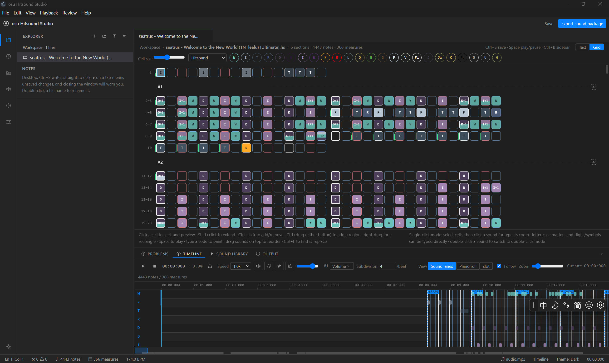
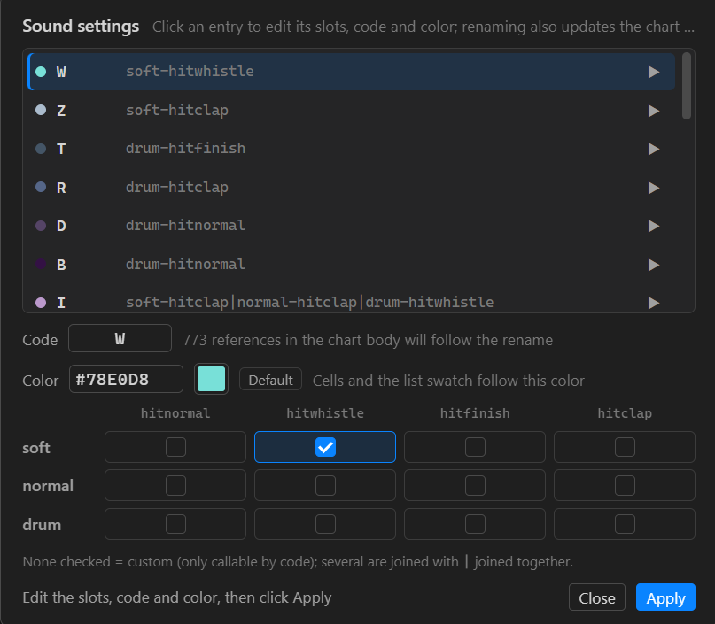
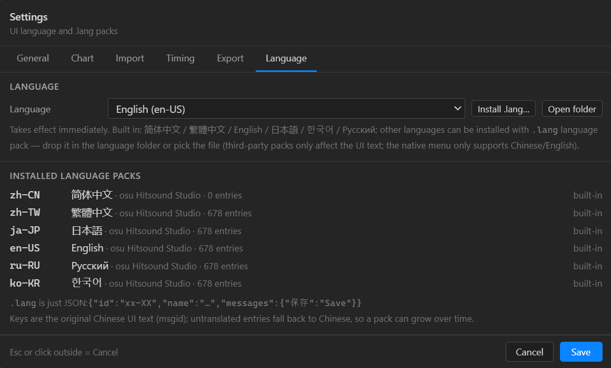

# osu Hitsound Studio

A desktop editor for **osu! code-based hitsound charts (`.hs` / musictxt)** with a VSCode-style UI — edit the chart as text, or place notes visually on a grid.



[English](#english-en_us) · [简体中文](#简体中文-zh_cn)

---

## English (en_US)

### You only need 3 steps to hitsound an osu beatmap:
1. Import the osu beatmap and sounds;
2. Assign the hitsound to the beat;
3. Export the hitsound to the osu beatmap.

### Features

- **Two editing modes**
  - Text mode: CodeMirror 6 with custom syntax highlighting, live diagnostics, find & replace.
  - Grid mode: one measure laid out as a grid; click or drag to place notes. Rectangle selection, Ctrl multi-select, copy/paste, clear, sections, volume marks, volume fades, undo/redo.
- **Hitsound**
  - Place notes by the codes defined in `[Define]`; single-click and double-click brushes; cell colors match code colors.
  - Built-in 22 official osu! default hitsounds (`default.*`) — preview without binding files. When the file name / reference name is itself a slot (e.g. `soft-hitnormal`), that slot is pre-checked on import.
  - "Sound settings" in the grid toolbar: list each code's slots, preview, select a code to change its slots, name or color; renaming also updates references in `[Hitsound]` and in phrases.
- **Keysound**
  - Multiple staves (`{piano | guitar}`), piano roll.
  - Multi-file (one wav/ogg per pitch, template or explicit file list) and single-file (`.sf2/.sf3` pick a preset by bank/program, `.sfz` maps regions, plain wav is pitched with C4 as the root); the old tuple syntax still works.
  - In grid mode the instrument selector turns the editor into a **piano keyboard**: click keys, or press `A~L` to type note names; digits / `Ctrl+↑↓` change octave, `Ctrl+←→` move the range or transpose the selection.
  - **Import MIDI / musictxt** (File menu, or drop a `.mid` onto the window): pick tracks, choose the target instrument, then quantize (1/4 – 1/64), offset, transpose and map velocity to volume in one pass into `[Keysound]`. You can also take the keysound track from another musictxt and carry its `[Define]` entry over (relative paths become absolute). If the target instrument doesn't exist yet, create the definition right there (folder / `.sf2` / `.sf3` / `.sfz`).
- **osu! interop**
  - Import a difficulty from `.osu` (saved as `.hs`, the source stays read-only), import hitsounds from `.osu`; dropping a `.osu` onto the window works too. Files that aren't real beatmaps (e.g. a txt renamed to `.osu`) are filtered out by the `osu file format vN` header + section checks, so they never show up in the difficulty list.
  - Export `.osu` (osu!-standard sample naming; `[TimingPoints]` sample sets are written as `soft`, no more d/n/s mixing or `auto` on green lines), export a hitsound package, export the timeline CSV / sound-map JSON / TXT.
  - **Import then export leaves audio files untouched**: the hitsound group index (`<n>`) in the `.hs` body carries over the original `.osu` `sampleIndex`, so exported file names line up one-to-one with the source folder; existing files with the same name and content are skipped. The order of `[Define]` doesn't affect indices; a group is only renumbered when its index is genuinely taken by another sound group, and you get a warning.
  - **Write hitsounds directly into an existing `.osu`** (a Hitsound Copier replacement): match object nodes (circle / slider head / repeat / slider tail / spinner end), add green lines automatically, copy or mix sample files; save as a new difficulty or overwrite the original with a `.bak` backup.
  - "Copy all hitsounds into the chart folder" packages everything in one click for sharing.
- **Audio**
  - Song playback in sync, metronome, separate music / hitsound / metronome volumes.
  - Auto-pair audio files from `[Files]`; bound samples can be previewed offline.
- **Workflow**
  - Multiple tabs, native disk read/write on desktop, unsaved-change prompts, Problems panel, Output panel.
  - Review panel: sound usage counts, slot conflicts, duplicate-slot detection.
  - Settings (theme / language / folders / import codes and colors / timing / export / new-chart defaults) are stored as one text file, `settings.cfg`: the portable build keeps it next to the exe (`release/osu-hitsound-studio/settings.cfg`) so the whole folder carries your settings; if the folder is read-only it falls back to `userData`. You can edit it by hand — restart or use "Reload" in Settings; invalid entries are skipped and the rest still load.
- **i18n**
  - Built-in 简体中文 / 繁體中文 / English / 日本語 / 한국어 / Русский, following the system language by default; pick one in Settings or install a `.lang` pack (JSON, msgid is the Chinese source string).

### Quick start

Requires **Node.js 18+** (the Windows desktop build uses Electron).

```bash
npm install

npm run electron:dev       # desktop (Vite + Electron, hot reload)
npm run dev                # browser (no local folder access; good for a look at the UI)
npm run build              # type check + build the renderer into dist/
npm run electron:portable  # build the portable app into release/osu-hitsound-studio/
```

On Windows you can also double-click `dev-start.bat` to launch the dev build.

### Chart syntax (musictxt)

```text
[Metadata]
Title = Sample
Artist = Someone

[Files]
audio = "song.wav"          ## relative to path (or to the .hs folder when path is omitted)
path = "D:/osu/Songs/xxx"   ## base folder for sounds / audio

[Define]
hitsound soft-hitnormal Aa = "clap.wav"
keysound custom piano = "piano/"
{lowest=A0,highest=C8,files="<loop("C","H","D","I","E","F","J","G","K","A","L","B")><int((i+9)/12)>.wav"}
keysound custom strings = "strings.sf2" {bank=0,program=48}

[Timing]
0,bpm(174),4,0,0

[Keysound]
{piano}
/4C D E F/

[Hitsound]
/Aa Aa Aa Aa/
/Aa = = = =/
```

Common patterns:

- `=` rest, `[Aa Ab]` chord, `(Aa = Ab)` subdivide one beat, `-` hold, `*3` repeat, `/5/` stretch the next measure over 5 measures.
- `<v=70>` set volume, `#02:03.456` / `#bookmark(0)` section markers.
- Keysound note names: `C H D I E F J G K A L B` (`H I J K L` are the black keys), octave before the letter (`4C` = C4).
- A keysound definition is "path + optional parameter block (same line or next line)":
  - Multi-file: the path ends with `/` or a backslash, and `files=` holds a template or a `{"A0.wav","A#0.wav"}` list (one file per semitone); `lowest` / `highest` accept MIDI numbers or note names (`21` / `A0`).
  - Single-file: the path doesn't end with a separator. `.sf2/.sf3` use `bank` / `preset` / `program` / `percussion` to pick a patch; `.sfz` takes the path directly; plain wav/ogg is pitched with C4 as the root.
  - The old `("template", A0, C8)` form is still supported.

### Project layout

```
src/core        parsing, write-back, import/export, chart model
src/components  UI (editor, grid, timeline, sidebar, dialogs)
src/audio       playback engine and samples
electron        main process / preload (files, menus, language packs, portable build)
public/osudefaulthitsound  built-in osu! default hitsounds
scripts         build scripts and CDP end-to-end tests
```

### Tests

UI tests run through Electron's CDP; on Windows:

```bash
npx tsx scripts/test-midi-import.ts       # MIDI parsing / quantization / import + definition transfer (50)
node scripts/cdp-midi-import.mjs          # drop MIDI / musictxt into [Keysound] (31)
npx tsx scripts/test-keysound-syntax.ts   # keysound syntax / SF2 / SFZ (41)
npx tsx scripts/test-keysound-grid.ts     # keysound grid write-back (38)
node scripts/cdp-keysound-grid.mjs        # keysound grid interaction (23)
node scripts/cdp-keysound-audio.mjs       # GM.sf2 → samples → auto-load → preview
node scripts/cdp-keysound-sf2.mjs         # SF2 single file + bank/program preset (8)
npx tsx scripts/test-roundtrip-index.ts    # keep original group indices / file-name fallback (31)
npx tsx scripts/test-roundtrip-files.ts    # real charts: export touches no audio files (6)
npx tsx scripts/test-settings-cfg.ts       # settings.cfg read/write and tolerance (50)
node scripts/cdp-settings-cfg.mjs          # settings.cfg create / save / hand-edit + restart (31)
npx tsx scripts/check-i18n.ts             # language pack coverage
```

`cdp-keysound-audio.mjs` needs `D:/Downloads/GM.sf2` and Python; it skips itself when they're missing.

### Screenshots

Hitsound Settings



Language Settings



### Notes

- This is a personal project; no open-source license has been chosen yet.
- The default sounds in `public/osudefaulthitsound` come from osu! and remain copyright osu! / peppy; they are included only for osu! beatmap compatibility.

---

## 简体中文 (zh_CN)

一个面向 **osu! 代码音效谱（`.hs` / musictxt）** 的桌面编辑器：VSCode 风格的界面，既能像写代码一样编辑文本，也能在格子里可视化落笔。

### 在OSU下音效只需要三步：
1. 导入谱面和各种音效
2. 把音效放在拍子上
3. 导出音效包

### 功能

- **双编辑模式**
  - 文本模式：CodeMirror 6，自定义语法高亮、实时诊断、查找替换。
  - 格子模式：一小节铺成网格，点/拖选落笔；支持矩形框选、Ctrl 多选区、复制粘贴、清空、分节、音量标记、音量渐变、撤销重做。
- **Hitsound**
  - 按 `[Define]` 里的代号落笔；单击 / 双击两种画笔；格子颜色跟代号颜色一致。
  - 内置 osu! 官方 22 个默认音效（`default.*`），不用绑定文件就能试听；文件名 / 引用名本身就是槽位时（如 `soft-hitnormal`），导入时自动勾上那个槽位。
  - 格子视图下拉里的「音效设置」：列出每个代号的槽位、试听、左键选中后改槽位、代号或颜色；改名会同步 `[Hitsound]` 正文与乐句里的引用。
- **Keysound**
  - 多谱表（`{piano | guitar}`）、钢琴卷帘。
  - 多文件（每个音高一个 wav/ogg，模板或文件列表）和单文件（`.sf2/.sf3` 按 bank/program
    选 preset，`.sfz` 按 region 映射，普通 wav 以 C4 为根音变调）；旧元组写法仍兼容。
  - 格子模式里按乐器切换成**钢琴键盘**：点键落笔，或按 `A~L` 直接输入音名；数字 / `Ctrl+↑↓` 换八度，`Ctrl+←→` 移范围或移调整段。
  - **导入 MIDI / musictxt**（文件菜单，或把 `.mid` 拖进窗口）：按轨道挑选音符，选目标乐器后量化
    （1/4 ~ 1/64）、整体偏移、移调、力度→音量，一次写进 `[Keysound]`；也可以从另一份 musictxt
    取它的 keysound 轨，并把该乐器的 `[Define]` 一并搬过来（相对路径会改成绝对路径）。
    目标乐器不在谱面里时可以当场新建定义（多文件目录 / `.sf2` / `.sf3` / `.sfz`）。
- **osu! 互操作**
  - 从 `.osu` 导入难度（另存为 `.hs`，原谱只读）、从 `.osu` 导入音效；也可以直接把 `.osu` 拖进窗口导入。
    不是真谱面的文件（比如 txt 改名成 `.osu`）会按 `osu file format vN` 头 + 段落检查过滤掉，不会出现在难度列表里。
  - 导出 `.osu`（按 osu! 标准音效命名；`[TimingPoints]` 的采样组统一写成 `soft`，绿线不再出现 d/n/s 混用或 auto）、
    导出音效包、导出时间轴 CSV / 音效映射 JSON / TXT。
  - **导入后再导出不会动音频文件**：`.hs` 正文里的音效组编号（`<n>`）沿用原 `.osu` 的
    `sampleIndex`，导出的文件名和源目录一一对应；已存在的同名同内容文件直接跳过。
    `[Define]` 的书写顺序不影响编号；只有编号真的被另一组音效占用时才会换号并给出提示。
  - **把音效直接写入现有 `.osu`**（替代 Mapping Tools 的 Hitsound Copier）：按物件节点匹配
    （圆圈 / 滑条头 / 折返点 / 滑条尾 / 转盘尾），自动补绿线、复制或混音音效文件；
    可另存为新难度，或覆盖原文件并备份 `.bak`。
  - 「将所有音效复制到谱面文件夹内」一键打包，方便发给别人。
- **音频**
  - 歌曲同步播放、节拍器、音乐 / 音效 / 节拍器三路音量。
  - 按 `[Files]` 自动配对同名音频，样本绑定后可离线试听。
- **工程化**
  - 多标签、桌面版直接读写磁盘、未保存提醒、问题面板、输出面板。
  - 审阅面板：音效使用次数、槽位冲突、重复槽位检测。
  - 设置（主题 / 语言 / 目录 / 导入代号与配色 / Timing / 导出 / 新谱默认值）会整份存成文本
    `settings.cfg`：绿色版就放在 exe 旁边（`release/osu-hitsound-studio/settings.cfg`），
    整个文件夹拷走配置跟着走；目录只读时自动退到 `userData`。
    文件可手改，重启或设置里「重新读取」生效；写错的项会跳过，其余照常读取。
- **i18n**
  - 内置简体中文 / 繁體中文 / English / 日本語 / 한국어 / Русский，默认跟随系统语言；
    可在设置里手动指定，或安装 `.lang` 语言包（JSON，msgid 为中文原文）。

### 快速开始

需要 **Node.js 18+**（Windows 桌面版使用 Electron）。

```bash
npm install

npm run electron:dev     # 桌面版（Vite + Electron，热更新）
npm run dev              # 浏览器版（读不到本地文件夹，适合看界面）
npm run build            # 类型检查 + 构建渲染进程到 dist/
npm run electron:portable  # 打便携版到 release/osu-hitsound-studio/
```

Windows 上也可以直接双击 `dev-start.bat` 启动开发版。

### 谱面语法（musictxt）

```text
[Metadata]
Title = Sample
Artist = Someone

[Files]
audio = "song.wav"          ## 相对 path（没写 path 就相对 .hs 所在目录）
path = "D:/osu/Songs/xxx"   ## 音效 / 音频的基准目录

[Define]
hitsound soft-hitnormal Aa = "clap.wav"
keysound custom piano = "piano/"
{lowest=A0,highest=C8,files="<loop("C","H","D","I","E","F","J","G","K","A","L","B")><int((i+9)/12)>.wav"}
keysound custom strings = "strings.sf2" {bank=0,program=48}

[Timing]
0,bpm(174),4,0,0

[Keysound]
{piano}
/4C D E F/

[Hitsound]
/Aa Aa Aa Aa/
/Aa = = = =/
```

常用写法：

- `=` 休止，`[Aa Ab]` 叠音，`(Aa = Ab)` 一拍内再分，`-` 延音，`*3` 重复，`/5/` 把下一小节摊到 5 小节。
- `<v=70>` 改音量，`#02:03.456` / `#bookmark(0)` 段落标记。
- Keysound 的音名：`C H D I E F J G K A L B`（`H I J K L` 是黑键），八度写在前面（`4C` = C4）。
- Keysound 定义是「路径 + 可选参数块（同行或下一行）」：
  - 多文件：路径以 `/` 或反斜杠结尾，`files=` 写模板或 `{"A0.wav","A#0.wav"}` 列表（每半音一个）；
    `lowest` / `highest` 认 MIDI 数字或音名（`21` / `A0`）。
  - 单文件：路径不以分隔符结尾。`.sf2/.sf3` 用 `bank` / `preset` / `program` / `percussion` 选音色；
    `.sfz` 直接写路径；普通 wav/ogg 会以 C4 为根音变调。
  - 旧写法 `("模板", A0, C8)` 仍然兼容。

### 目录结构

```
src/core        解析、写回、导入导出、谱面模型
src/components  界面（编辑器、格子、时间轴、侧栏、弹窗）
src/audio       播放引擎与样本
electron        主进程 / preload（文件、菜单、语言包、便携版）
public/osudefaulthitsound  内置的 osu! 默认音效
scripts         构建脚本与 CDP 端到端测试
```

### 测试

界面相关的测试通过 Electron 的 CDP 跑，Windows 下执行：

```bash
npx tsx scripts/test-midi-import.ts       # MIDI 解析 / 量化 / 导入与定义搬运（50 项）
node scripts/cdp-midi-import.mjs          # 拖 MIDI / musictxt 导入到 [Keysound]（31 项）
npx tsx scripts/test-keysound-syntax.ts   # keysound 语法 / SF2 / SFZ（41 项）
npx tsx scripts/test-keysound-grid.ts     # 格子 keysound 写回（38 项）
node scripts/cdp-keysound-grid.mjs        # 格子 keysound 交互（23 项）
node scripts/cdp-keysound-audio.mjs       # 用 GM.sf2 生成样本 → 自动载入 → 试听
node scripts/cdp-keysound-sf2.mjs         # SF2 单文件 + bank/program 选 preset（8 项）
npx tsx scripts/test-roundtrip-index.ts    # 音效组编号沿用 / 文件名回退（31 项）
npx tsx scripts/test-roundtrip-files.ts    # 真实谱面：导出不动任何音频文件（6 项）
npx tsx scripts/test-settings-cfg.ts       # settings.cfg 读写与容错（50 项）
node scripts/cdp-settings-cfg.mjs          # settings.cfg 生成 / 保存 / 手改重启（31 项）
npx tsx scripts/check-i18n.ts             # 语言包覆盖率
```

`cdp-keysound-audio.mjs` 需要 `D:/Downloads/GM.sf2` 和 Python；没有会自动跳过。

### 说明

- 这是个人项目，尚未选择开源许可证。
- `public/osudefaulthitsound` 里的默认音效来自 osu!，版权归 osu! / peppy 所有，仅用于兼容 osu! 谱面。
