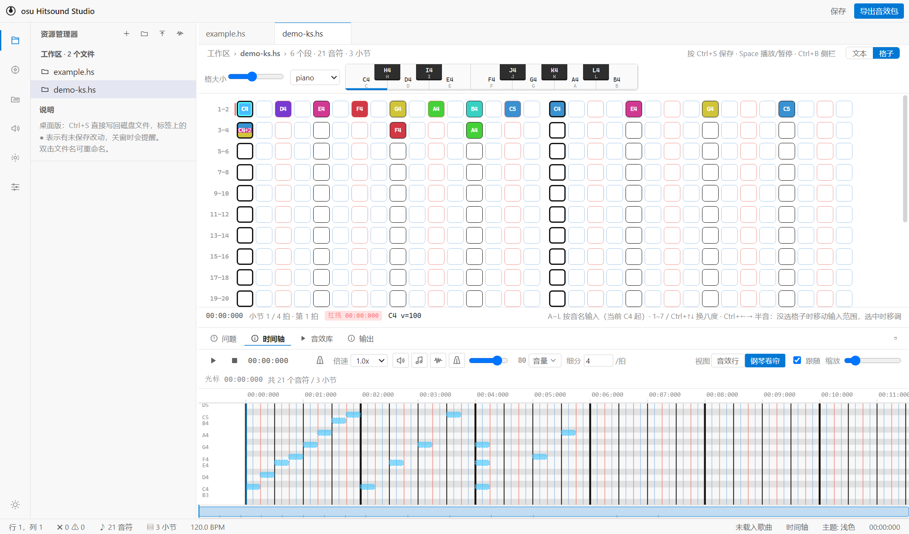
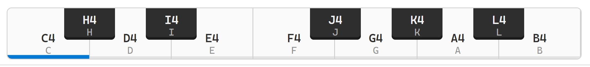

# osu Hitsound Studio

一个面向 **osu! 代码音效谱（`.hs` / musictxt）** 的桌面编辑器：VSCode 风格的界面，既能像写代码一样编辑文本，也能在格子里可视化落笔。



## 功能

- **双编辑模式**
  - 文本模式：CodeMirror 6，自定义语法高亮、实时诊断、查找替换。
  - 格子模式：一小节铺成网格，点/拖选落笔；支持矩形框选、Ctrl 多选区、复制粘贴、清空、分节、音量标记、撤销重做。
- **Hitsound**
  - 按 `[Define]` 里的代号落笔；单击 / 双击两种画笔；格子颜色跟代号颜色一致。
  - 内置 osu! 官方 22 个默认音效（`default.*`），不用绑定文件就能试听；文件名 / 引用名本身就是槽位时（如 `soft-hitnormal`），导入时自动勾上那个槽位。
  - 格子视图下拉里的「音效设置」：列出每个代号的槽位、试听、左键选中后改槽位、代号或颜色；改名会同步 `[Hitsound]` 正文与乐句里的引用。
- **Keysound**
  - 多谱表（`{piano | guitar}`）、每个音高一个 wav 的模板定义、钢琴卷帘。
  - 格子模式里按乐器切换成**钢琴键盘**：点键落笔，或按 `A~L` 直接输入音名；数字 / `Ctrl+↑↓` 换八度，`Ctrl+←→` 移范围或移调整段。
- **osu! 互操作**
  - 从 `.osu` 导入难度（另存为 `.hs`，原谱只读）、从 `.osu` 导入音效；也可以直接把 `.osu` 拖进窗口导入。
    不是真谱面的文件（比如 txt 改名成 `.osu`）会按 `osu file format vN` 头 + 段落检查过滤掉，不会出现在难度列表里。
  - 导出 `.osu`（按 osu! 标准音效命名；`[TimingPoints]` 的采样组统一写成 `soft`，绿线不再出现 d/n/s 混用或 auto）、
    导出音效包、导出时间轴 CSV / 音效映射 JSON / TXT。
  - 「将所有音效复制到谱面文件夹内」一键打包，方便发给别人。
- **音频**
  - 歌曲同步播放、节拍器、音乐 / 音效 / 节拍器三路音量。
  - 按 `[Files]` 自动配对同名音频，样本绑定后可离线试听。
- **工程化**
  - 多标签、桌面版直接读写磁盘、未保存提醒、问题面板、输出面板。
  - 审阅面板：音效使用次数、槽位冲突、重复槽位检测。
- **i18n**
  - 内置简体中文 / English，可安装 `.lang` 语言包（JSON，msgid 为中文原文）。

## 快速开始

需要 **Node.js 18+**（Windows 桌面版使用 Electron）。

```bash
npm install

npm run electron:dev     # 桌面版（Vite + Electron，热更新）
npm run dev              # 浏览器版（读不到本地文件夹，适合看界面）
npm run build            # 类型检查 + 构建渲染进程到 dist/
npm run electron:portable  # 打便携版到 release/osu-hitsound-studio/
```

Windows 上也可以直接双击 `dev-start.bat` 启动开发版。

## 谱面语法（musictxt）

```text
[Metadata]
Title = Sample
Artist = Someone

[Files]
audio = "song.wav"          ## 相对 path（没写 path 就相对 .hs 所在目录）
path = "D:/osu/Songs/xxx"   ## 音效 / 音频的基准目录

[Define]
hitsound soft-hitnormal Aa = "clap.wav"
keysound custom piano = ("piano/<loop("C","H","D","I","E","F","J","G","K","A","L","B")><int((i+9)/12)>.wav", A0, C8)

[Timing]
0,bpm(174),4,0,0

[Keysound]
{piano}
/4C D E F/

[Hitsound]
/Aa Aa Aa Aa/
/Aa = = = =/
```

常用写法：

- `=` 休止，`[Aa Ab]` 叠音，`(Aa = Ab)` 一拍内再分，`-` 延音，`*3` 重复，`/5/` 把下一小节摊到 5 小节。
- `<v=70>` 改音量，`#02:03.456` / `#bookmark(0)` 段落标记。
- Keysound 的音名：`C H D I E F J G K A L B`（`H I J K L` 是黑键），八度写在前面（`4C` = C4）。

## 目录结构

```
src/core        解析、写回、导入导出、谱面模型
src/components  界面（编辑器、格子、时间轴、侧栏、弹窗）
src/audio       播放引擎与样本
electron        主进程 / preload（文件、菜单、语言包、便携版）
public/osudefaulthitsound  内置的 osu! 默认音效
scripts         构建脚本与 CDP 端到端测试
```

## 测试

界面相关的测试通过 Electron 的 CDP 跑，Windows 下执行：

```bash
npx tsx scripts/test-keysound-grid.ts     # 格子 keysound 写回（38 项）
node scripts/cdp-keysound-grid.mjs        # 格子 keysound 交互（18 项）
node scripts/cdp-keysound-audio.mjs       # 用 GM.sf2 生成样本 → 自动载入 → 试听
npx tsx scripts/check-i18n.ts             # 语言包覆盖率
```

`cdp-keysound-audio.mjs` 需要 `D:/Downloads/GM.sf2` 和 Python；没有会自动跳过。

## 截图

格子视图（keysound 模式，音符按音高着色）：


钢琴键盘：点键落笔，或按 `A~L` 输入同名音符：



## 说明

- 这是个人项目，尚未选择开源许可证。
- `public/osudefaulthitsound` 里的默认音效来自 osu!，版权归 osu! / peppy 所有，仅用于兼容 osu! 谱面。
